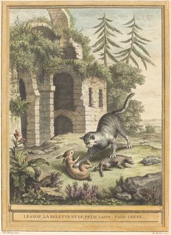
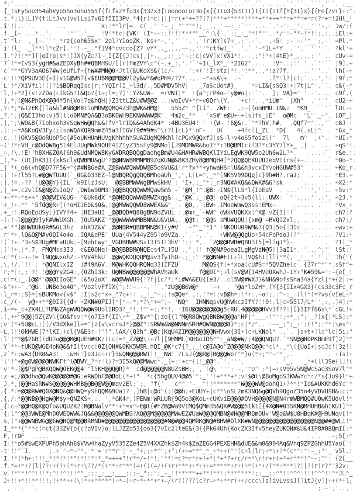

<html>

    
    

# Le chat, la balette et le petit lapin (The Cat, the Weasel, and the Rabbit)

## Artwork Details

- Date: published 1756
- Category: Print
- Medium: Hand-colored etching
- Image rights: Courtesy National Gallery of Art, Washington

Additional details about the artwork can be found [here](https://www.artsy.net/artwork/martin-marvie-after-jean-baptiste-oudry-le-chat-la-balette-et-le-petit-lapin-the-cat-the-weasel-and-the-rabbit).

## Contact

Got questions, compliments, or just wanna chat about the latest tech trends? Shoot me an email
at [hellocanardev@gmail.com](mailto:hellocanardev@gmail.com). I promise not to hit you with any spam—just good vibes and
maybe a few lines of code.

</html>
